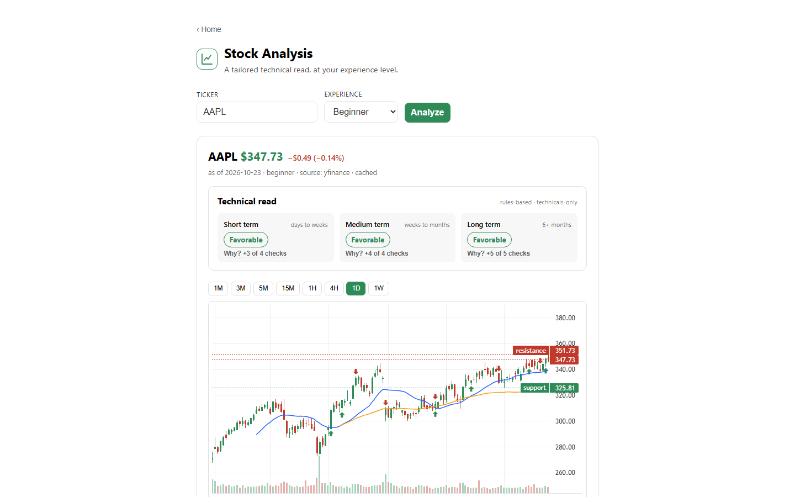
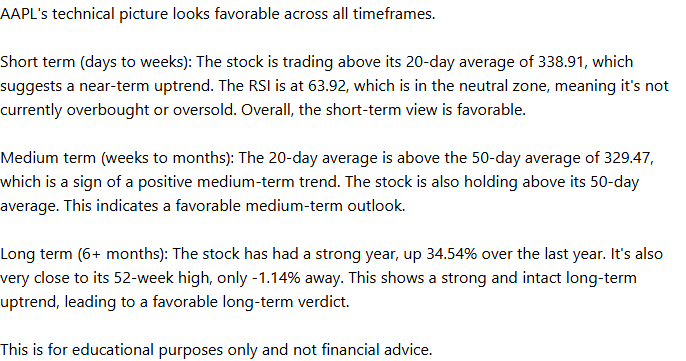
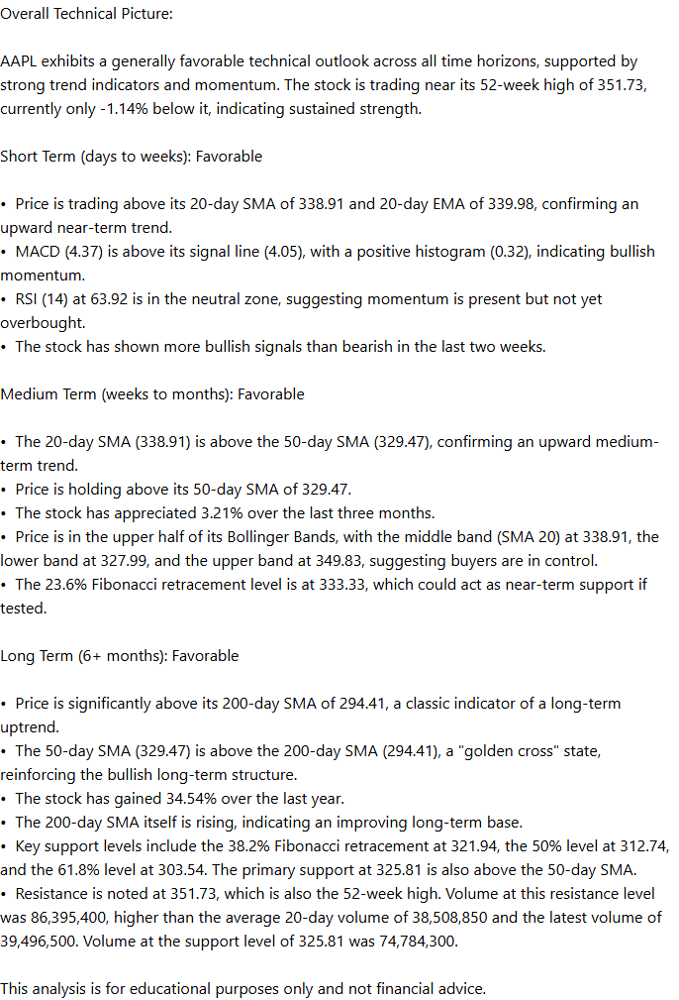
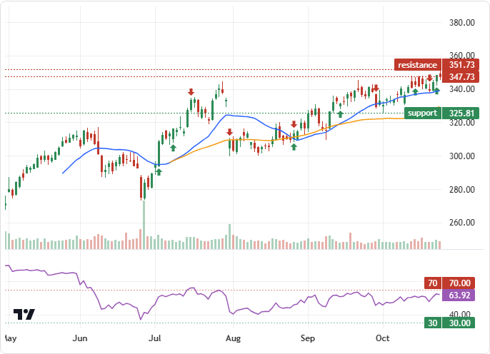
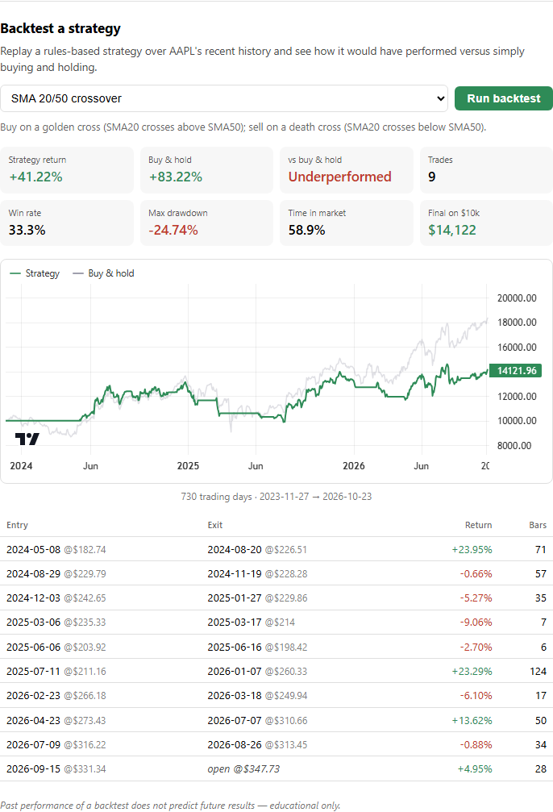
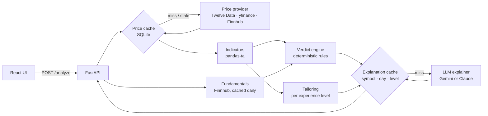

# Personalized Stock Analysis

A full-stack web app that gives a plain-language technical read of any stock,
tailored to the reader's experience level. Enter a ticker and the backend pulls
daily price history, computes 28 technical indicators locally, and scores the
stock as favorable, neutral or unfavorable over short, medium and long horizons
(company fundamentals feed the long one). An LLM then explains those
pre-computed numbers and ratings in a beginner, intermediate or advanced voice.
It never calculates or decides anything itself. The app also shows a candlestick
chart with detected signals and a backtester that compares simple strategies
against buy-and-hold.

## Screenshots

<!-- Each image follows the viewer's GitHub theme. Regenerate both with scripts/take_screenshots.py. -->

<picture>
  <source media="(prefers-color-scheme: dark)" srcset="docs/screenshots/analysis-dark.png">
  
</picture>

<table>
  <tr>
    <th>Beginner explanation</th>
    <th>Advanced explanation</th>
  </tr>
  <tr>
    <td valign="top">
      <picture>
        <source media="(prefers-color-scheme: dark)" srcset="docs/screenshots/explanation-beginner-dark.png">
        
      </picture>
    </td>
    <td valign="top">
      <picture>
        <source media="(prefers-color-scheme: dark)" srcset="docs/screenshots/explanation-advanced-dark.png">
        
      </picture>
    </td>
  </tr>
</table>

<picture>
  <source media="(prefers-color-scheme: dark)" srcset="docs/screenshots/chart-dark.png">
  
</picture>

<picture>
  <source media="(prefers-color-scheme: dark)" srcset="docs/screenshots/backtester-dark.png">
  
</picture>

## How it works

The rule that shapes the design: **code computes, the LLM explains.** Every
indicator value and every rating is produced by deterministic Python before the
LLM sees anything. The prompt hands the model those numbers as JSON and forbids
it from calculating, inventing or re-grading values. That keeps figures out of
the model's hands, where they could be hallucinated, and makes the ratings
reproducible.



1. **Price data:** daily OHLCV from a pluggable `PriceProvider`, stored in
   SQLite and only refetched when stale.
2. **Indicators:** RSI, MACD, Bollinger Bands, moving averages, Fibonacci
   levels, volume-at-price and more, all computed locally with pandas-ta. That's
   one data call per ticker instead of a paid call per indicator.
3. **Verdict:** `verdict.py` scores each horizon from explicit, inspectable
   factors (trend, momentum, signals and, for the long term, valuation, growth,
   margins and leverage).
4. **Tailoring:** each experience level sees a different subset of indicators
   (7, 22 or 28) and different chart overlays.
5. **Explanation:** a pluggable `Explainer` (Gemini 2.5 Flash by default, Claude
   Haiku 4.5 optional) turns the numbers and the verdict into prose for that
   level.

## Tech stack

| Layer | Tools |
|---|---|
| Backend | Python, FastAPI, SQLAlchemy, SQLite, pandas, pandas-ta, httpx |
| LLM | Google Gemini 2.5 Flash (default) or Anthropic Claude Haiku 4.5 |
| Market data | Twelve Data (default), yfinance, Finnhub (fundamentals) |
| Frontend | React 18, Vite 6, TradingView lightweight-charts v5 |
| Tooling | Offline smoke test, Playwright for screenshots |

## Caching: at most 3 LLM calls per ticker per day

Explanations are cached in SQLite under a unique key of
`(symbol, trading day, experience level)`. With three levels, a ticker can
trigger at most three LLM calls per trading day, however many times it's
viewed. Price data is cached per symbol and trading day (only missing bars are
fetched), fundamentals once per symbol per day, and intraday charts for five
minutes in memory. Each response carries a `cached_explanation` flag, so cache
hits are visible in the UI.

## Run it locally

Requires Python 3.12+ and Node 18+.

**1. Backend**

```bash
cd backend
python -m venv .venv
source .venv/bin/activate        # Windows: .venv\Scripts\activate
pip install -r requirements.txt
cp .env.example .env             # Windows: copy .env.example .env
```

Fill in `backend/.env`. Both keys below are free:

| Variable | Purpose |
|---|---|
| `TWELVE_DATA_API_KEY` | Price data, from [twelvedata.com](https://twelvedata.com/). Or set `PRICE_PROVIDER=yfinance` to skip the key. |
| `GOOGLE_API_KEY` | Gemini explanations, from [aistudio.google.com](https://aistudio.google.com/) |
| `FINNHUB_API_KEY` | Optional. Enables fundamentals in the long-term verdict. |
| `ANTHROPIC_API_KEY` | Optional. Use Claude instead, with `EXPLAIN_PROVIDER=claude`. |

Without an LLM key the app still runs and shows the raw indicator values
in place of a narrative.

```bash
uvicorn app.main:app --reload    # http://localhost:8000/docs
```

**2. Frontend** (in a second terminal)

```bash
cd frontend
npm install
npm run dev                      # http://localhost:5173
```

The Vite dev server proxies `/api` to the backend, so no CORS setup is needed.

**Verify without keys or network:**

```bash
cd backend
python -m scripts.smoke_test
```

This runs the indicator, tailoring, verdict and backtest layers on synthetic
data, with assertions.

**Regenerate the screenshots** (dev-only dependency, with both servers running):

```bash
pip install playwright
playwright install chromium
python scripts/take_screenshots.py
```

> Behind a TLS-inspecting corporate proxy? The backend uses the OS trust store
> automatically. yfinance needs `CURL_CA_BUNDLE` pointed at an exported CA bundle.

## Disclaimer

This is an educational project, not financial advice. The ratings come from
simple rule-based scoring of public price and fundamentals data, and nothing
here is a recommendation to buy or sell any security.
